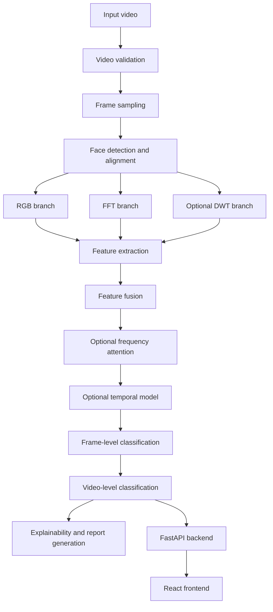
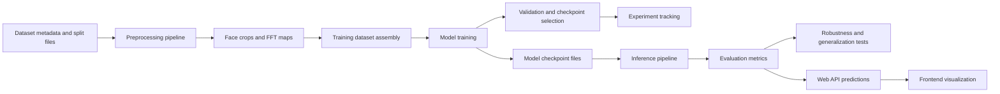

# Frequency-Aware Deepfake Detection and Video Forensics

A research-focused project for detecting manipulated videos by combining spatial, frequency-domain, and temporal evidence from face regions. This repository is intended to evolve from a documented specification into a reproducible ML pipeline and local web application. The system is designed to support experiments, forensic-style reporting, and an end-to-end user workflow without assuming that frequency artifacts are always present or unique to deepfakes.

## Table of contents

- [Project overview](#project-overview)
- [Features](#features)
- [Technology stack](#technology-stack)
- [System architecture](#system-architecture)
- [Machine learning architecture](#machine-learning-architecture)
- [Dataset strategy](#dataset-strategy)
- [Data leakage prevention](#data-leakage-prevention)
- [Repository structure](#repository-structure)
- [Implementation roadmap](#implementation-roadmap)
- [Training configuration](#training-configuration)
- [Evaluation and ablation study](#evaluation-and-ablation-study)
- [API and frontend usage](#api-and-frontend-usage)
- [Installation and run commands](#installation-and-run-commands)
- [Reproducibility and experiment tracking](#reproducibility-and-experiment-tracking)
- [Limitations, privacy, and responsible use](#limitations-privacy-and-responsible-use)
- [Troubleshooting](#troubleshooting)
- [Final project status](#final-project-status)

---

## Project overview

### Problem and motivation

Deepfake videos can manipulate appearance, identity, and expression in ways that are often convincing to a human viewer. Traditional image- and video-based forgery detection methods may struggle when manipulation quality varies, compression increases, or distribution shifts occur between datasets and real-world domains. This project explores whether frequency-domain representations, especially information derived from the Fourier spectrum and wavelet subbands, provide complementary signals to RGB-based CNN features for deepfake detection.

The project is founded on the idea that many manipulation pipelines leave detectable traces in image statistics, frequency content, and temporal consistency. However, this is not assumed to be universally true. The project explicitly treats that hypothesis as experimental: every feature family must be validated with appropriate ablations and held-out evaluations before being considered useful.

### Primary objectives

1. Detect real vs. manipulated videos.
2. Extract and analyze facial regions from video frames.
3. Learn spatial features with an RGB-based CNN.
4. Extract frequency representations using FFT.
5. Fuse RGB and FFT features for improved detection.
6. Investigate wavelet-based features and their contribution.
7. Study frequency-band attention and temporal consistency.
8. Benchmark generalization to unseen manipulation methods and external datasets.
9. Produce interpretable outputs such as suspicious-frame rankings and forensic-style reports.
10. Package the pipeline in a local web application using FastAPI and React.
11. Maintain reproducible experiments and clear documentation.

### Intended users

This project is intended for:

- ML researchers studying deepfake detection and forensic signal analysis.
- Engineers building local prototypes for video forensics.
- Students and researchers learning end-to-end model development and evaluation.
- Developers validating a deployable experimental web application.

### Expected outputs

The system is expected to produce:

- Video-level real/fake predictions.
- Frame-level confidence scores and suspicious-frame rankings.
- RGB, FFT, and wavelet visualizations.
- Evaluation metrics and ablation comparisons.
- Checkpoint metadata and experiment logs.
- A local inference API and frontend UI.
- A summary report explaining model decisions and limitations.

### Limitations and scope

This project is explicitly research-oriented and not a production forensics system. It is designed for experimental validation and educational use. Current README content documents the intended architecture and workflow; actual model performance, robustness, and deployment readiness must be proven by runs, tests, and evaluation results.

This project does not assume that:

- Frequency artifacts are always present.
- A single manipulation signal is sufficient across all deepfake generation methods.
- A model trained on one dataset will generalize perfectly to all others.
- A confidence score is proof of deception.

### Implemented vs planned

The following status is intentionally conservative:

- Implemented: documentation, the application scaffold, the Python 3.11 environment setup, and the Phase 2 metadata contract with focused tests.
- Planned: data preprocessing, model development, inference behavior, evaluation runs, and production hardening.
- Not yet implemented: model code, training runs, metrics, video processing, and real inference.

---

## Features

### Core features

These are the core research and ML capabilities planned for the system. All items below are marked as planned until they are implemented and verified.

- Video upload and validation.
- Frame sampling from input videos.
- Face detection and cropping from video frames.
- RGB-based deepfake classification.
- FFT feature extraction and classification.
- RGB + FFT feature fusion.
- Frame-level and video-level prediction.
- Evaluation metrics and experiment tracking.

### Advanced research features

- DWT wavelet analysis.
- Frequency-band attention.
- Temporal GRU or Transformer model.
- Cross-dataset evaluation.
- Unseen-manipulation evaluation.
- Robustness testing under compression, resizing, blur, noise, and color transforms.
- Grad-CAM or comparable explainability.
- Spectral statistics and frequency fingerprint analysis.
- Optional manipulation-type classification when reliable labels are available.

### Application features

- FastAPI inference backend.
- React + Vite frontend.
- Prediction result visualization.
- Frame timeline and suspicious-frame ranking.
- FFT visualizations.
- Forensic report generation.
- Health-check endpoint and input validation.

All application features should be considered planned until explicitly implemented, tested, and documented with actual results.

---

## Technology stack

This project is intended to use modern, open-source tooling and reproducible Python-based ML workflows.

### Core ML and data processing

- Python 3.11: primary language for training, preprocessing, and evaluation.
- PyTorch: model training, tensor operations, and deep learning.
- TorchVision: pretrained backbones, transforms, and utilities.
- OpenCV: video decoding, frame extraction, face detection support, and image processing.
- FFmpeg: video decoding, frame extraction, and format conversion when needed.
- NumPy: numerical arrays and signal processing foundations.
- SciPy: scientific operations and signal analysis helpers.
- PyWavelets: wavelet transforms for DWT experiments.
- scikit-learn: metrics, splitting utilities, model evaluation, and calibration analysis.
- Pandas: metadata handling and experiment summaries.
- Matplotlib: plotting, visual diagnostics, and FFT map generation.
- Pillow: image loading and preprocessing.
- tqdm: progress bars for long-running preprocessing or training jobs.
- pytest: automated tests for data validation, preprocessing, and model utilities.

### Web application stack

- FastAPI: API for inference and health checks.
- Uvicorn: ASGI server for FastAPI.
- React: frontend user interface.
- Vite: fast frontend build tooling.
- Tailwind CSS: UI styling for the React app.

### Version control and reproducibility

- Git and GitHub: source control, issue tracking, and experiment documentation.

### Model backbone and detector selection

- ResNet18 is the initial CNN backbone for small-scale experiments because it balances representation capability, training speed, and ease of experimentation.
- Face detection is planned to use either RetinaFace or MTCNN, with the final choice determined after checking compatibility with the environment, model weight availability, and installation complexity.
- The installation method for the chosen detector must be documented clearly in the project setup instructions.

### Licensing and service considerations

- Prefer free and open-source tools whenever practical.
- Do not introduce paid APIs or mandatory paid services as project dependencies.
- Free hosted GPU services may impose quotas, availability limits, or runtime restrictions; these constraints should be documented when used for experiments.

---

## System architecture

### Intended end-to-end architecture



### Development architecture



### Component purpose and data flow

- Input video: original user-uploaded or local dataset video.
- Video validation: checks container format, frame readability, and supported metadata.
- Frame sampling: selects a manageable subset of frames for initial experiments.
- Face detection and alignment: identifies faces and normalizes them to a consistent input size.
- RGB branch: feeds aligned face crops into a CNN backbone.
- FFT branch: computes frequency-domain maps from the same face crop or derived frames.
- DWT branch: computes wavelet subbands for additional signal analysis.
- Feature extraction: produces embeddings or intermediate feature vectors from each branch.
- Feature fusion: combines branch outputs into a single classifier input.
- Frequency attention: learns how to weight frequency bands or subbands depending on evidence.
- Temporal model: aggregates frame-level evidence over a sequence of embeddings.
- Explainability and report generation: produces suspicious-frame rankings, FFT visualizations, and forensic summaries.
- FastAPI backend: exposes trained artifacts to a local application.
- React frontend: allows uploading videos and displaying predictions and visualizations.

---

## Machine learning architecture

The project is intentionally organized as a set of comparable baselines and ablation studies. Each model should be implemented, trained, evaluated, and reported separately before making stronger claims about superiority.

### Model 1: RGB baseline

- Input: face crops resized to 224 x 224.
- Backbone: pretrained ResNet18.
- Output: real/fake classification logit.
- Use case: establish a baseline for comparison against frequency-aware methods.
- Training target: binary classification using BCEWithLogitsLoss.

### Model 2: FFT baseline

- Input: normalized FFT magnitude representation.
- Backbone: ResNet18 or a documented equivalent architecture.
- Output: real/fake classification logit.
- Use case: determine whether spectral information alone provides useful signal.
- Notes: careful normalization and consistent preprocessing are required to avoid brittle comparisons.

### Model 3: RGB + FFT fusion

- Extract features from both RGB and FFT branches.
- Concatenate feature vectors after the CNN backbones or feature heads.
- Pass combined features through a classification head.
- Compare against both single-branch baselines.
- Use case: test whether complementary spatial and spectral information improves detection.

### Model 4: DWT-enhanced model

- Extract approximation and detail subbands such as horizontal, vertical, and diagonal components.
- Evaluate either a separate wavelet branch or wavelet-derived statistical features.
- Measure contribution through ablation studies.
- Use case: determine whether wavelet information adds signal beyond the RGB + FFT features.

### Model 5: Frequency-attention model

- Pool features across frequency bands or subbands.
- Learn attention weights with a small neural network.
- Integrate weighted features into the fusion architecture.
- Use case: test whether frequency-specific weighting improves generalization or robustness.

### Model 6: Temporal model

- Process a sequence of frame-level features.
- Implement a GRU or a small Transformer encoder.
- Compare with mean and median frame-score aggregation.
- Use case: determine whether temporal modeling captures consistency or motion-related forgery cues beyond simple frame averaging.

### Tensor shape guidance

Tensor shapes should be checked during implementation rather than assumed. Example shape conventions may include:

- Input RGB crop: `(B, 3, 224, 224)`
- FFT magnitude input: `(B, 1, H, W)` or `(B, 3, H, W)` depending on representation choice
- Backbone features: depends on the stage selected for feature aggregation
- Fusion vector: concatenation of branch-specific embeddings
- Temporal model input: `(B, T, D)` where `T` is sequence length and `D` is feature dimension

Implementation should verify actual dimensions after selecting final preprocessing and model definitions.

---

## Dataset strategy

The project should begin with a small, well-understood subset of permitted data and expand only after the baseline pipeline is stable and the metadata workflow is validated.

### Candidate datasets

1. FaceForensics++
   - Initial benchmark and model development dataset.
   - Link: https://github.com/ondyari/FaceForensics
2. Celeb-DF
   - External generalization evaluation dataset.
   - Link: https://github.com/yuezunli/celeb-deepfakeforensics
3. DeepFake Detection Challenge (DFDC)
   - Optional extension for larger-scale experimentation.
   - Link: https://www.kaggle.com/c/deepfake-detection-challenge

### Important data usage requirements

- Before downloading or processing data, check the dataset license, access requirements, and permitted use.
- Do not assume all datasets allow unrestricted redistribution or training use.
- Start with a small permitted subset to validate the pipeline and reduce unnecessary storage cost.
- Do not commit large datasets, private videos, or model weights to the repository.

### Metadata schema

The following schema is a minimum starting point for metadata management. It should be persisted in a structured format and validated before training.

- `video_id`
- `video_path`
- `label`
- `manipulation_type`
- `identity_group` (when available)
- `frame_index`
- `face_path`
- `split`
- `preprocessing_version`

### Recommended metadata handling practices

- Preserve a stable `video_id` from the raw dataset to the preprocessed face crop.
- Record split membership at the source-video level, not just at the frame level.
- Store dataset provenance and preprocessing version because feature extraction, face detection, and cropping can change over time.
- Track failed face crops, dropped frames, and any label discrepancies.

---

## Data leakage prevention

This section is mandatory and must be treated as a core engineering rule.

- Split datasets by source video before extracting frames.
- Never place frames from the same source video in different splits.
- Use training data for gradient updates.
- Use validation data for checkpoint selection and model tuning.
- Keep the test set untouched until final evaluation.
- Where feasible, isolate identities and manipulation sources for stronger evaluation.
- Detect duplicate and near-duplicate frames.
- Preserve the original video ID throughout preprocessing and training.
- Document any deviations from this protocol.

### Why frame-level random splitting is unsafe

Random frame-level splitting can create misleadingly high results because adjacent frames from the same video share an identity, background, compression artifacts, and manipulation characteristics. If the model sees the same source video across training and validation or test splits, it learns source-specific artifacts instead of true generalization. That can inflate metrics and provide an overly optimistic estimate of real-world performance.

---

## Repository structure

The repository should be organized as a clean research project with explicit ML and application layers. The structure below is the intended target architecture. Keep the current phase focused and create only files needed at the moment; do not create dozens of empty placeholders just to look complete.

```text
frequency-deepfake-detector/
├── README.md
├── requirements.txt
├── .gitignore
├── configs/
│   └── baseline.yaml
├── data/
│   ├── raw/
│   ├── faces/
│   └── metadata/
├── scripts/
│   ├── extract_frames.py
│   ├── extract_faces.py
│   ├── create_splits.py
│   └── build_metadata.py
├── src/
│   ├── datasets/
│   │   └── video_dataset.py
│   ├── preprocessing/
│   │   ├── face_detection.py
│   │   ├── fft.py
│   │   ├── dwt.py
│   │   └── frequency_features.py
│   ├── models/
│   │   ├── rgb_model.py
│   │   ├── fft_model.py
│   │   ├── fusion_model.py
│   │   ├── attention.py
│   │   └── temporal_model.py
│   ├── training/
│   │   ├── train.py
│   │   └── losses.py
│   ├── evaluation/
│   │   ├── metrics.py
│   │   ├── robustness.py
│   │   └── cross_dataset.py
│   └── inference/
│       └── video_predictor.py
├── backend/
│   └── app/
│       ├── main.py
│       └── routes/
├── frontend/
├── checkpoints/
├── experiments/
└── tests/
```

For this documentation step, only the files directly relevant to the README and project setup should be created. Additional folders and files can be added when their functionality is actually implemented.

---

## Implementation roadmap

Each phase below describes the objective, likely files, tasks, validation approach, expected outputs, and conditions required before moving to the next phase. These are starting points for implementation and must be updated when actual project constraints are known.

Execution order note: this project will follow a hybrid delivery order for implementation: the web application skeleton (backend + frontend) is created first to validate the end-to-end workflow, then data contracts and metadata are defined, and only then the ML pipeline is implemented. This order is intended to reduce integration risk early in the project while preserving the research-first validation discipline later in the pipeline.

### Phase 0 — Documentation and workspace setup

Objective:
- Establish a clear technical specification and ensure the repository root is ready for implementation.

Files to create or modify:
- `README.md`
- `.gitignore`
- Optional environment setup notes if needed

Implementation tasks:
- Create the README specification.
- Document the Python environment, dependencies, and initial setup.
- Define repository conventions and implementation goals.
- Verify commands and instructions are realistic.

Commands to run:

```powershell
Get-ChildItem
py -3.11 --version
```

Automated tests and manual validation:
- Verify the README renders cleanly in GitHub markdown.
- Confirm the TOC links are valid.
- Check that commands are framed as planned rather than claiming success.

Acceptance criteria:
- README includes all required sections.
- Project status is explicit and conservative.
- No fabricated ML test claims.

Expected output:
- A documented specification for the whole project.

Common failure cases:
- Overclaiming that models or backend endpoints already work.
- Missing required sections or inconsistent phase names.

Before moving to next phase:
- The README must be reviewed and approved.

### Phase 1 — Application skeleton and contract definition

Objective:
- Establish the backend and frontend structure first so that the application can accept uploads, show status, and later plug in inference and report generation without changing the surrounding architecture.

Files to create or modify:
- `backend/app/main.py`
- `backend/app/routes/*.py`
- `frontend/package.json`
- `frontend/src/*`
- `requirements.txt` or equivalent environment setup file

Implementation tasks:
- Create a minimal FastAPI app with health-check and upload route scaffolding.
- Create a minimal React + Vite app skeleton.
- Define initial API payload and response contracts for upload, prediction, and report result handling.
- Add basic CORS and error handling placeholders.
- Add frontend pages for video upload and preview placeholder states.

Commands to run:

```powershell
python -m venv .venv
.\.venv\Scripts\Activate.ps1
python -m pip install --upgrade pip
python -m pip install fastapi uvicorn pytest
cd frontend
npm install
npm run dev
```

Automated tests and manual validation:
- Confirm app boots without runtime errors.
- Validate that the frontend can reach the backend health endpoint.
- Verify upload form and response state placeholders render correctly.

Acceptance criteria:
- Backend service starts locally.
- Frontend app renders a working entry screen.
- The API contract exists before model integration.

Expected output:
- A local scaffold for app interaction and integration testing.

Common failure cases:
- CORS issues between frontend and backend.
- Incomplete request/response schema.
- App boots but does not have a clear upload and status flow.

Before moving to next phase:
- The backend and frontend must successfully communicate in a local development environment.

### Phase 2 — Data contracts and metadata

Objective:
- Create clean, consistent metadata and labeling contracts before training.

Files to create or modify:
- `data/metadata/*.csv` or JSON metadata files
- `src/datasets/metadata.py`
- `tests/test_metadata.py`

Implementation tasks:
- Define the metadata schema.
- Validate file paths and labels.
- Build a video-level split utility.
- Detect duplicates and leakage risks.
- Add tests for invalid records.

Commands to run:

```powershell
python -m pytest tests/test_metadata.py -q
```

Automated tests and manual validation:
- Validate dataset paths.
- Confirm that no duplicate video IDs appear unexpectedly.
- Check split logic to prevent leakage.

Acceptance criteria:
- Metadata schema is consistent and documented.
- Video-level split logic is correct.

Current implementation:
- `MetadataRecord` validates required fields, labels, splits, and frame indexes.
- CSV loading rejects missing columns and malformed rows.
- Duplicate frame rows and inconsistent video-level attributes are rejected.
- Deterministic source-video split assignment prevents frame-level leakage.

Expected output:
- Valid dataset metadata files and a fixed split policy.

Common failure cases:
- Random frame-level splitting.
- Missing labels or inconsistent IDs.

Before moving to next phase:
- Video metadata must be validated and reproducible.

### Phase 3 — Frame extraction and face preprocessing

Objective:
- Convert videos to valid face crops while preserving source metadata.

Files to create or modify:
- `scripts/extract_frames.py`
- `scripts/extract_faces.py`
- Data preprocessing utilities

Implementation tasks:
- Sample 5–10 frames per video for early experiments.
- Detect and crop faces.
- Resize crops to 224 x 224.
- Save preprocessing logs and failure cases.

Commands to run:

```powershell
python scripts/extract_frames.py --help
python scripts/extract_faces.py --help
```

Automated tests and manual validation:
- Validate crop dimensions.
- Confirm no face crop is stored without the corresponding video ID.
- Inspect the preprocessing failure log.

Acceptance criteria:
- Frame extraction produces valid face crops.
- Metadata links remain consistent.

Expected output:
- A cleaned face dataset suitable for model experiments.

Common failure cases:
- Face detection failures on compressed or side-profile videos.
- Inconsistent channel ordering.

Before moving to next phase:
- Face dataset passes shape and metadata checks.

### Phase 3 — FFT feature extraction

Objective:
- Implement a deterministic FFT preprocessing pipeline and validate its output.

Files to create or modify:
- `src/preprocessing/fft.py`
- Feature extraction tests

Implementation tasks:
- Compute 2D FFT per crop.
- Shift zero-frequency component to center.
- Compute log magnitude and normalize consistently.
- Save example FFT outputs for debugging.

Commands to run:

```powershell
python -m pytest tests/test_fft.py -q
```

Automated tests and manual validation:
- Verify output shape and dtype.
- Check deterministic behavior.
- Test invalid inputs.

Acceptance criteria:
- FFT pipeline is stable and repeatable.
- Generated features are traceable to the correct face crop.

Expected output:
- FFT maps and normalized frequency features.

Common failure cases:
- Channel-order confusion.
- Inconsistent normalization between train and evaluation.

Before moving to next phase:
- FFT output matches expected shapes and conventions.

### Phase 4 — RGB baseline

Objective:
- Train an RGB-only classifier as the primary baseline.

Files to create or modify:
- `src/models/rgb_model.py`
- `src/training/train.py`
- `configs/baseline.yaml`

Implementation tasks:
- Use ResNet18 with a binary classification head.
- Train using BCEWithLogitsLoss.
- Use AdamW as the initial optimizer.
- Save validation checkpoints.

Commands to run:

```powershell
python src/training/train.py --config configs/baseline.yaml
```

Automated tests and manual validation:
- Run a short smoke experiment.
- Confirm checkpoint save/load.
- Check training and validation metrics.

Acceptance criteria:
- Model trains without NaN loss and saves a valid checkpoint.
- Validation metrics are logged.

Expected output:
- A baseline RGB model with recorded metrics.

Common failure cases:
- OOM due to batch size.
- Data loader mismatch and shape errors.

Before moving to next phase:
- At least one valid training run must complete on the test subset.

### Phase 5 — FFT baseline

Objective:
- Train an FFT-only model and compare with the RGB baseline.

Files to create or modify:
- `src/models/fft_model.py`
- Training configuration and evaluation script

Implementation tasks:
- Use the same split and comparable training protocol.
- Evaluate whether FFT-only features are competitive.

Commands to run:

```powershell
python src/training/train.py --model fft --config configs/baseline.yaml
```

Automated tests and manual validation:
- Baseline metric comparison.
- Confirm that raw outputs are reproducible.

Acceptance criteria:
- FFT-only model can be trained reliably.
- Results are documented in comparison tables.

Expected output:
- An FFT-only performance report.

Common failure cases:
- Overfitting small subsets.
- Metric misinterpretation from data leakage.

Before moving to next phase:
- Results are recorded with the same evaluation protocol.

### Phase 6 — RGB + FFT fusion

Objective:
- Test whether RGB and FFT features are complementary.

Files to create or modify:
- `src/models/fusion_model.py`
- Fusion evaluation utilities

Implementation tasks:
- Build independent feature extractors.
- Concatenate representations.
- Add a classification head.
- Run ablation comparison.

Commands to run:

```powershell
python src/training/train.py --model fusion --config configs/baseline.yaml
```

Automated tests and manual validation:
- Verify tensor dimensions and gradient flow.
- Compare fusion results against RGB and FFT baselines.

Acceptance criteria:
- Model train loop completes successfully.
- A valid performance comparison is produced.

Expected output:
- Fusion model metrics and ablation report.

Common failure cases:
- Feature dimension mismatch.
- Improper concatenation order.

Before moving to next phase:
- Fusion model has measurable results and a documented comparison table.

### Phase 7 — DWT and frequency attention

Objective:
- Evaluate additional frequency-aware signals and attention strategies.

Files to create or modify:
- `src/preprocessing/dwt.py`
- `src/models/attention.py`
- Experiment configuration files

Implementation tasks:
- Add Haar DWT preprocessing.
- Study approximation and detail subbands.
- Test a small frequency attention module.

Commands to run:

```powershell
python -m pytest tests/test_dwt.py -q
python src/training/train.py --model attention --config configs/baseline.yaml
```

Automated tests and manual validation:
- Confirm wavelet outputs are stable.
- Compare across ablation groups.

Acceptance criteria:
- DWT features are not silently ignored.
- Attention model is evaluated under the same protocol.

Expected output:
- DWT and attention experiment results.

Common failure cases:
- Incorrect band normalization.
- Attention over-parameterization on small datasets.

Before moving to next phase:
- The effect of attention and DWT must be documented with evidence.

### Phase 8 — Temporal modelling

Objective:
- Compare temporal aggregation with frame-only scoring.

Files to create or modify:
- `src/models/temporal_model.py`
- Sequence dataset utilities

Implementation tasks:
- Sample 8–16 frames per video.
- Build GRU or small Transformer sequence model.
- Compare against mean and median frame score aggregation.

Commands to run:

```powershell
python src/training/train.py --model temporal --config configs/baseline.yaml
```

Automated tests and manual validation:
- Validate sequence data loader.
- Measure video-level performance.

Acceptance criteria:
- Temporal model is properly benchmarked.
- Results are compared to non-temporal baselines.

Expected output:
- Video-level temporal results and comparison table.

Common failure cases:
- Sequence length mismatch.
- Overly long training time on small hardware.

Before moving to next phase:
- A fair temporal-vs-aggregation comparison exists.

### Phase 9 — Evaluation and generalization

Objective:
- Measure real detection quality with proper evaluation metrics and external generalization tests.

Files to create or modify:
- `src/evaluation/metrics.py`
- `src/evaluation/cross_dataset.py`

Implementation tasks:
- Compute accuracy, precision, recall, F1, ROC-AUC, confusion matrices.
- Evaluate cross-dataset performance when permitted.
- Report external dataset and unseen-manipulation results.

Commands to run:

```powershell
python -m pytest tests/test_metrics.py -q
python src/evaluation/run_evaluation.py --config configs/baseline.yaml
```

Automated tests and manual validation:
- Confirm metric calculations are correct.
- Verify a held-out test split is used for final results.

Acceptance criteria:
- Metrics are computed without leakage.
- Cross-dataset evaluation is documented with caveats.

Expected output:
- A report with metrics and generalization notes.

Common failure cases:
- Reporting accuracy without recall/precision/F1 context.
- Mixing train and test data during evaluation.

Before moving to next phase:
- Final evaluation protocol is locked and documented.

### Phase 10 — Robustness and explainability

Objective:
- Understand model behavior under real-world distortions and produce interpretable outputs.

Files to create or modify:
- `src/evaluation/robustness.py`
- `src/inference/video_predictor.py`
- Visualization helper utilities

Implementation tasks:
- Evaluate compression, resize, blur, noise, and color changes.
- Add Grad-CAM or equivalent explainability.
- Produce suspicious-frame timelines and FFT visuals.

Commands to run:

```powershell
python src/evaluation/run_robustness.py
```

Automated tests and manual validation:
- Confirm output plots and logs are generated.
- Check that visualization labels are accurate.

Acceptance criteria:
- Robustness behavior is described with evidence.
- Explanations are cautious and not overinterpreted.

Expected output:
- A robustness report and explanatory outputs.

Common failure cases:
- Claiming interpretability without evidence.
- Hard-to-reproduce transformation settings.

Before moving to next phase:
- The project reports uncertainty and limitations in a responsible manner.

### Phase 11 — FastAPI backend

Objective:
- Expose model inference through a validated, testable API.

Files to create or modify:
- `backend/app/main.py`
- `backend/app/routes/*.py`

Implementation tasks:
- Add `GET /health`.
- Add `POST /predict`.
- Validate file format and request payloads.
- Return useful errors and structured responses.

Commands to run:

```powershell
uvicorn backend.app.main:app --reload --host 0.0.0.0 --port 8000
```

Automated tests and manual validation:
- Use API tests with small sample videos.
- Confirm validation errors are clear and actionable.

Acceptance criteria:
- API is reachable and returns expected HTTP status codes.
- Request validation works.

Expected output:
- A working local inference API.

Common failure cases:
- Upload timeout or file-size mismatch.
- Model loading issues at startup.

Before moving to next phase:
- All health-check and inference tests pass.

### Phase 12 — React frontend

This phase is intentionally scheduled earlier in the hybrid project order, right after the backend and app skeleton are in place, so the upload flow, user interaction, and API contract can be validated before the ML pipeline is built.

Objective:
- Provide a local, intuitive UI for video upload and prediction review.

Files to create or modify:
- `frontend/*`
- Frontend integration tests

Implementation tasks:
- Create React + Vite application.
- Add upload, preview, and status UI.
- Display model output and suspicious-frame timeline.
- Integrate API endpoints.

Commands to run:

```powershell
cd frontend
npm install
npm run dev
```

Automated tests and manual validation:
- Confirm upload works in a test environment.
- Validate frontend/backend communication.

Acceptance criteria:
- UI loads and can call the backend.
- Output visualizations display correctly.

Expected output:
- A functioning prototype interface.

Common failure cases:
- CORS or API mismatch.
- Browser UI blocking large uploads.

Before moving to next phase:
- API and frontend integration is validated end-to-end.

### Phase 13 — Final integration and documentation

Objective:
- Consolidate all validated work into a clean final project state.

Files to create or modify:
- README, environment files, deployment notes, final test logs

Implementation tasks:
- Run full available test suite.
- Verify checkpoint loading and inference behavior.
- Confirm API and frontend communication.
- Update setup, usage, limitations, and troubleshooting.

Commands to run:

```powershell
python -m pytest -q
```

Automated tests and manual validation:
- End-to-end smoke test for a sample video.
- Check that all doc instructions remain accurate.

Acceptance criteria:
- Documentation matches actual functionality.
- Status reflects tested vs untested work honestly.

Expected output:
- Final implementation status report.

Common failure cases:
- Documentation drift from implementation.
- Testing after the fact without reproducing earlier results.

Before moving to completion:
- The project has a clear state: implemented, tested, or planned.

---

## Training configuration

The settings below are initial starting points, not guaranteed optimal values. They should be treated as configuration defaults to test first, then adapted based on actual hardware and results.

- Image size: 224 x 224
- Initial frame sampling: 5–10 frames per video
- Initial temporal sequence: 8–16 frames per video
- Backbone: ResNet18
- Optimizer: AdamW
- Initial learning rate: 1e-4
- Loss: BCEWithLogitsLoss
- Initial batch size: 4–8, adjusted to available memory
- Smoke test: 5–10 epochs
- Checkpoint selection: based on validation metrics
- Random seed: configurable
- Device selection: CPU or GPU
- Number of workers: configurable
- Dataset paths: configurable
- Checkpoint directory: configurable
- Logging directory: configurable

### Mixed precision and memory management

Mixed precision training should be used where supported to increase throughput and reduce GPU memory requirements. If GPU memory is limited, reduce batch size before changing the model architecture. Training stability and memory usage should be monitored under realistic hardware conditions.

### Configuration management recommendations

Keep a YAML config file for settings such as:

- random seed
- dataset paths
- preprocessing version
- batch size
- learning rate
- weight decay
- epochs
- device selection
- checkpoint directory
- experiment name

The project should log model hyperparameters and environment details so a result can be reproduced later.

---

## Evaluation and ablation study

The evaluation plan should compare the following variants under the same data split and reporting protocol:

1. RGB only
2. FFT only
3. RGB + FFT
4. RGB + FFT + DWT
5. RGB + FFT + DWT + frequency attention
6. Temporal model vs mean/median frame-score aggregation

### Required metrics

- F1-score
- ROC-AUC
- Accuracy
- Precision
- Recall
- Confusion matrix
- Video-level performance
- External-dataset generalization
- Inference latency and memory usage

### Experiment table template

| Experiment | F1-score | ROC-AUC | Video-level F1 | External dataset results | Inference latency | Notes |
| --- | --- | --- | --- | --- | --- | --- |
| RGB only |  |  |  |  |  |  |
| FFT only |  |  |  |  |  |  |
| RGB + FFT |  |  |  |  |  |  |
| RGB + FFT + DWT |  |  |  |  |  |  |
| RGB + FFT + DWT + attention |  |  |  |  |  |  |
| Temporal model |  |  |  |  |  |  |

Results should remain blank until actual experiments have been run and reported.

### Why metrics matter

Accuracy alone is not sufficient for this problem because class imbalance may make a model look accurate while still missing manipulated examples. Precision, recall, F1-score, and ROC-AUC provide more meaningful insight, especially when real and manipulated videos are unevenly distributed. Cross-dataset testing matters because deepfake detectors frequently overfit to a specific generation pipeline or dataset artifact rather than learning truly generalizable cues.

---

## API and frontend usage

The backend and frontend are part of the project vision but should be treated as planned functionality until tested and verified.

### Planned API endpoints

- `GET /health`
- `POST /predict`
- `GET /results/{id}` when asynchronous processing is implemented
- `GET /report/{id}` when report generation is implemented

The actual request/response schema should be established only after the validated inference pipeline exists and API tests are written.

### Intended frontend workflow

1. Upload a supported video.
2. Validate the file.
3. Process frames and faces.
4. Run model inference.
5. Display the video-level result and frame scores.
6. Show frequency visualizations and limitations.
7. Export a report if implemented.

Never describe planned endpoints as working endpoints until they are tested with real requests.

---

## Installation and run commands

The following commands are intended as project setup instructions and should be treated as planned until the environment is validated.

### Python environment setup (Windows PowerShell)

```powershell
py -3.11 -m venv .venv
.\.venv\Scripts\Activate.ps1
python -m pip install --upgrade pip
```

### Install PyTorch

PyTorch must be installed using the official selector at:

https://pytorch.org/get-started/locally/

This avoids incorrect CPU/GPU package combinations and version issues.

### Dependency installation

```powershell
.\.venv\Scripts\python.exe -m pip install -r requirements.txt
```

The repository is validated with Python 3.11. The pinned SciPy version is compatible with the Python 3.11 wheel set, and `httpx` is included for FastAPI's test client.

### Planned commands for project tasks

#### Run unit tests

```powershell
.\.venv\Scripts\python.exe -m pytest -q
```

#### Preprocess data

```powershell
python scripts/extract_frames.py --help
python scripts/extract_faces.py --help
```

#### Train a model

```powershell
python src/training/train.py --config configs/baseline.yaml
```

#### Run evaluation

```powershell
python src/evaluation/run_evaluation.py --config configs/baseline.yaml
```

#### Run FastAPI backend

```powershell
uvicorn backend.app.main:app --reload --host 0.0.0.0 --port 8000
```

#### Run React frontend

```powershell
cd frontend
npm install
npm run dev
```

If scripts or frontend files do not exist yet, those commands should be clearly marked as planned rather than presented as working instructions.

---

## Reproducibility and experiment tracking

Reproducibility is a project requirement. Every experiment should be traceable from configuration to checkpoint and result.

Required tracking elements:

- Random seeds
- Configuration files
- Dataset split identifiers
- Preprocessing versions
- Model checkpoint metadata
- Training logs and metrics
- Environment and dependency versions
- Experiment naming conventions
- Instructions to reproduce a reported result

### Recommended experiment logging

Each run should record:

- model name
- dataset subset used
- split IDs
- preprocessing version
- training hyperparameters
- validation metrics
- checkpoint path
- timestamp and author
- hardware summary (if available)

This allows later comparison across baselines and ablations without relying on memory or unstored assumptions.

---

## Limitations, privacy, and responsible use

- A model prediction is not proof that a video is fake or real.
- False positives and false negatives are possible.
- Compression, resizing, and post-processing can affect predictions.
- Generalization to unseen manipulation methods must be tested explicitly.
- Training data may contain demographic and identity-related biases.
- Uploaded videos should not be retained longer than necessary.
- Dataset terms and consent requirements must be respected.
- Results should not be used as the sole basis for high-stakes accusations or decisions.

This project should be used as a research and detection aid, not as a definitive forensic authority. Responsible use requires transparency about uncertainty, error rates, and dataset limitations.

---

## Troubleshooting

The following issues are common in deepfake detection and ML pipelines and should be documented in operational guidance:

- PyTorch cannot detect CUDA.
- Out-of-memory errors during training.
- Face detection failures on low-quality or compressed footage.
- Corrupt or unsupported video files.
- Missing dataset files or inconsistent paths.
- Inconsistent RGB/BGR channel ordering.
- Model checkpoint mismatch after code changes.
- API upload size and timeout errors.
- Frontend/backend CORS errors.
- Dependency version conflicts between Python packages and system libraries.

Each troubleshooting item should be addressed with a concrete diagnostic step and a likely fix path rather than vague advice.

---

## Final project status

The project is in hybrid implementation: the application scaffold and metadata contracts are being established before model work. The status of each implementation phase is updated only when evidence exists.

| Phase | Status |
| --- | --- |
| Phase 0 — Documentation and workspace setup | Complete |
| Phase 1 — Application skeleton and contract definition | In progress |
| Phase 2 — Data contracts and metadata | In progress |
| Phase 3 — Frame extraction and face preprocessing | Planned |
| Phase 4 — FFT feature extraction | Planned |
| Phase 5 — RGB baseline | Planned |
| Phase 6 — FFT baseline | Planned |
| Phase 7 — RGB + FFT fusion | Planned |
| Phase 8 — DWT and frequency attention | Planned |
| Phase 9 — Temporal modelling | Planned |
| Phase 10 — Evaluation and generalization | Planned |
| Phase 11 — Robustness and explainability | Planned |
| Phase 12 — Final integration and documentation | Planned |

Never mark a phase as completed without evidence from tests, training runs, or successful validation.

---

## Notes for the next implementation step

This document remains the specification gate for the project. The next step is Phase 3 frame extraction only after the Phase 2 metadata contract is reviewed and accepted. No model implementation should begin before the preprocessing and split contracts are validated.

---

## Summary

This repository is intended to become a reproducible deepfake detection project that blends RGB spatial features, FFT-based frequency evidence, optional DWT signals, and temporal modeling. The project will emphasize careful data hygiene, ablation-driven research, and responsible reporting. It is designed for local experimentation and research validation, not as a claim that deepfake detection is solved by a single model or a single signal.

The initial goal is not to produce a final production model. The goal is to generate a clean, scientific specification that another AI assistant or developer can implement phase by phase without ambiguity.
# Frequency-Aware-Deepfake-Detection-API

